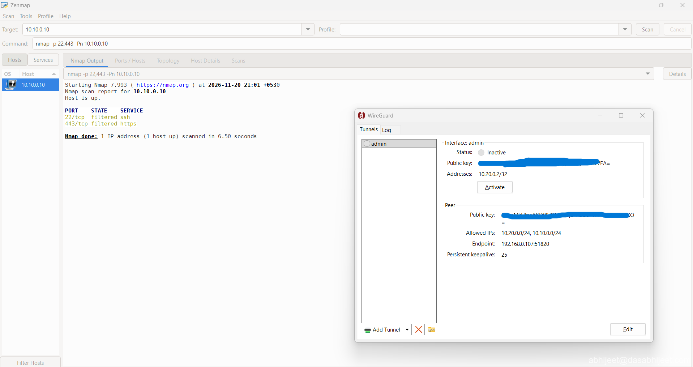
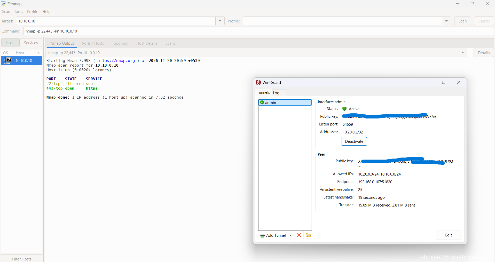
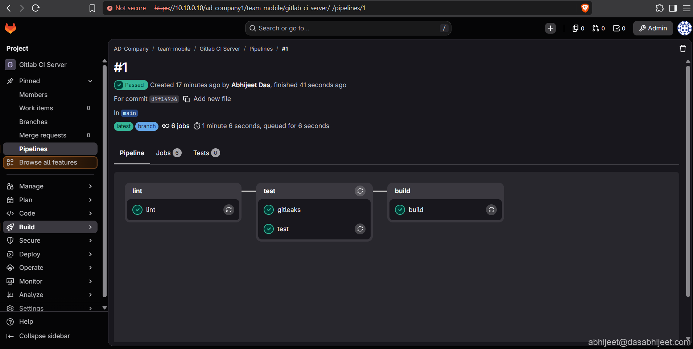
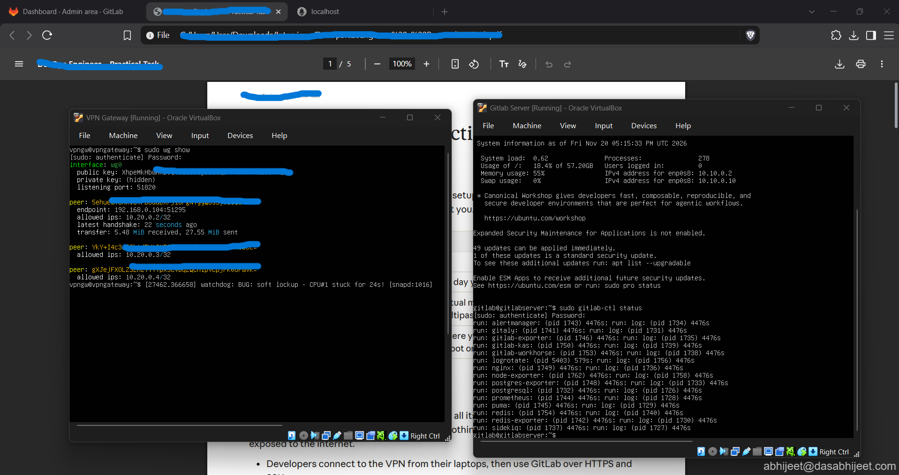
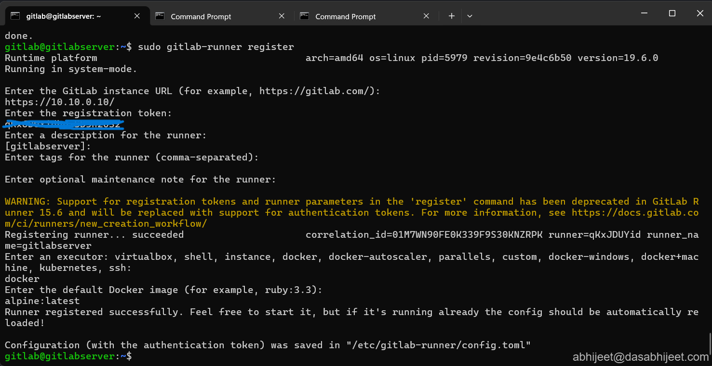
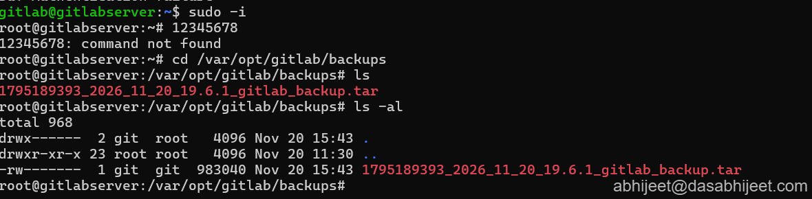

# Self-Hosted GitLab Behind a VPN

Private GitLab CE + CI/CD runner, reachable only through a WireGuard VPN. No public IP on the GitLab box, no public CI runner. Two VMs, zero cloud cost.

Architecture: see [ARCHITECTURE.md](ARCHITECTURE.md).

📝 Read the full write-up: [I Built a Private GitLab Server From Scratch: My Self-Hosting Journey](https://dasabhijeet.com/i-built-a-private-gitlab-server-from-scratch-my-self-hosting-journey/)

## Stack
Ubuntu Server 24.04 (x2) · WireGuard · GitLab CE (Omnibus) · GitLab Runner (Docker executor) · UFW · gitleaks

## Quick Start

### 1. Network (`netplan set`, not hand-edited YAML)
```bash
# vpn-gw
sudo netplan set ethernets.enp0s8.dhcp4=true
sudo netplan set ethernets.enp0s9.addresses=[10.10.0.1/24]
sudo netplan apply

# gitlab
sudo netplan set ethernets.enp0s8.addresses=[10.10.0.2/24,10.10.0.10/24]
sudo netplan set "ethernets.enp0s8.routes=[{to: default, via: 10.10.0.1}]"
sudo netplan apply
```

### 2. Forwarding + NAT (on `vpn-gw`)
```bash
echo "net.ipv4.ip_forward=1" | sudo tee /etc/sysctl.d/99-ipforward.conf
sudo sysctl -p /etc/sysctl.d/99-ipforward.conf
sudo iptables -P FORWARD ACCEPT
```

### 3. WireGuard
```bash
sudo apt install -y wireguard
wg genkey | tee server.key | wg pubkey > server.pub
sudo cp configs/wg0.conf /etc/wireguard/wg0.conf   # fill in real keys first
sudo chmod 600 /etc/wireguard/wg0.conf
sudo systemctl enable --now wg-quick@wg0
```

### 4. Firewall
```bash
sudo bash configs/ufw-rules.sh
```

### 5. GitLab
```bash
curl https://packages.gitlab.com/install/repositories/gitlab/gitlab-ce/script.deb.sh | sudo bash
sudo EXTERNAL_URL="https://10.10.0.10" apt install -y gitlab-ce
sudo gitlab-ctl reconfigure
```
Then: disable sign-up, enforce 2FA, set default-private, create groups/users, protect `main`.

### 6. Runner
```bash
curl -fsSL https://get.docker.com | sudo sh
curl -L "https://packages.gitlab.com/install/repositories/runner/gitlab-runner/script.deb.sh" | sudo bash
sudo apt install -y gitlab-runner
sudo gitlab-runner register   # use a group-scoped glrt- token, executor=docker
```
CI config: [`configs/.gitlab-ci.yml`](configs/.gitlab-ci.yml)

### 7. Backup + Restore
```bash
sudo gitlab-backup create
sudo cp /etc/gitlab/gitlab-secrets.json /var/opt/gitlab/backups/
sudo cp /etc/gitlab/gitlab.rb /var/opt/gitlab/backups/
```
Restore onto a fresh instance to prove it actually works:
```bash
sudo gitlab-ctl stop puma && sudo gitlab-ctl stop sidekiq
sudo gitlab-backup restore BACKUP=<timestamp>
sudo gitlab-ctl reconfigure && sudo gitlab-ctl restart
```

## Security Highlights
- No direct push to `main` — merge request only, Maintainer-approved
- 2FA enforced, sign-up disabled, projects private by default
- Per-user WireGuard keys, split-tunnel, instant one-command revocation
- Masked/protected CI variables, `gitleaks` secret scanning in-pipeline
- `gitlab` VM has one network interface only — no direct path in or out except through the VPN gateway

## Screenshots







---
Personal infrastructure project. All config files in `configs/` use placeholder keys/tokens — replace before use.
